# Infraestructura 2: Jump Server con RemoteApp y VPN de acceso remoto

**Autor:** Omar Paulino · **Matrícula:** 20251325
**Plataforma:** GNS3 · FortiGate VM 7.0.9 · Cisco c2691 · Cisco IOSvL2 · Windows Server 2022 · Windows 11 · Ubuntu Cloud 24.04 · VMware Workstation

---

## Video de demostración

https://youtu.be/eZrzZ8dCu60?si=slqORsDFpeU0dd8e

En el video muestro la topología, la configuración del FortiGate y del Jump Server, y las pruebas con los dos usuarios:

- **usuario1325** se conecta por VPN, solo ve la aplicación Web y tiene el SSH bloqueado.
- **admin1325** ve Web, PuTTY y Escritorio remoto, y desde el Jump Server administra el Web Server por HTTPS, SSH y RDP.

---

## Contenido

1. [Propósito de la práctica](#1-propósito-de-la-práctica)
2. [Topología](#2-topología)
3. [Direccionamiento IP](#3-direccionamiento-ip)
4. [Cableado en GNS3](#4-cableado-en-gns3)
5. [Credenciales del laboratorio](#5-credenciales-del-laboratorio)
6. [Equipos de red: ISP, R1 y switches](#6-equipos-de-red-isp-r1-y-switches)
7. [FortiGate (FMW2-1325)](#7-fortigate-fmw2-1325)
8. [Web Server "Sistema de Caja"](#8-web-server-sistema-de-caja)
9. [Jump Server (OMAR1325)](#9-jump-server-omar1325)
10. [PC-USUARIOS: VPN y RemoteApp Web Client](#10-pc-usuarios-vpn-y-remoteapp-web-client)
11. [Resumen de las reglas de acceso](#11-resumen-de-las-reglas-de-acceso)
12. [Pruebas y resultados](#12-pruebas-y-resultados)

---

## 1. Propósito de la práctica

El objetivo de esta práctica fue **dar acceso remoto seguro a los servidores de una empresa a través de un Jump Server**, sin exponer los servidores directamente.

- Un usuario remoto se conecta con una **VPN de acceso remoto** al FortiGate. La VPN solo le deja llegar al **Jump Server**, nunca directo al resto de servidores.
- El Jump Server es un **Windows Server con Remote Desktop Services**. Publica aplicaciones (**RemoteApp**) que el usuario abre desde el navegador con el **RD Web Client**, sin instalar nada más en su PC.
- Lo que cada usuario puede hacer depende de su perfil:
  - El usuario **sin privilegios** solo ve la aplicación **Web** (el Sistema de Caja), y el FortiGate le bloquea el SSH con reglas explícitas.
  - El usuario **con privilegios** ve **Web, PuTTY y Escritorio remoto**, y con ellas administra el Web Server.
- El Jump Server solo puede hablar con el Web Server por **HTTPS, RDP y SSH**.

Con esto demuestro el modelo de **bastión** (*jump host*): un único punto de entrada, auditado y con permisos por usuario, entre los usuarios remotos y los servidores.

### Requisitos y cómo los cumplí

| Requisito | Cómo lo cumplí |
| --- | --- |
| VPN Remote-Site entre el cliente y el servidor | VPN IPsec de acceso remoto `VPN-RA-1325` en el FortiGate (IKEv1 + XAUTH) y el cliente **Shrew Soft VPN Client** en el PC |
| La VPN solo da acceso al Jump Server | Las políticas que salen del túnel solo aceptan tráfico hacia `SRV-JUMP`. Una DENY explícita (`DENY-VPN-A-WEB`) bloquea la VPN hacia la LAN del Web Server |
| El Jump Server solo accede al Web Server por HTTPS, RDP y SSH | Política `JUMP-A-WEB` con exactamente esos tres servicios. Todo lo demás cae en el Implicit Deny |
| Cada servidor en su propia LAN /29 | Web Server en `10.13.25.128/29` (port2) y Jump Server en `10.13.25.136/29` (port3) |
| RemoteApp y RemoteApp Web Client | Remote Desktop Services en el Jump Server con RD Web Client (HTML5) en `https://omar1325.omar1325.local/RDWeb/webclient/` |
| Usuario sin privilegios: solo el servicio Web | RemoteApp **Web - Sistema de Caja** asignada a su grupo `GRP-RA-USUARIOS` |
| Usuario sin privilegios: políticas explícitas que restringen el SSH | `DENY-USUARIO-SSH-JUMP` y `DENY-USUARIO-SSH-WEB` en el FortiGate, aplicadas a su grupo `GRP-VPN-USUARIOS` |
| Usuario con privilegios: Web, PuTTY y RDP | RemoteApps **Web - Sistema de Caja**, **PuTTY (SSH)** y **Escritorio remoto (RDP)** asignadas a `GRP-RA-ADMINS` |
| Dos usuarios en una /25, VLAN 10, DHCP | Red `10.13.25.0/25` en la VLAN 10, con DHCP del router R1-1325. El PC-USUARIOS lo usan los dos usuarios |
| ISP con IP públicas | Switch del ISP con las IP públicas simuladas `200.25.13.13` (R1) y `200.25.13.25` (FortiGate) |

---

## 2. Topología

### Topología en GNS3

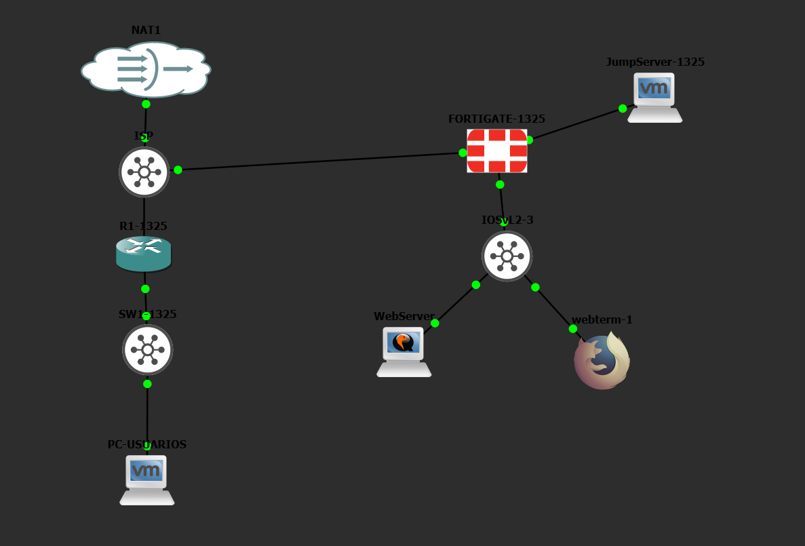

### Diagrama lógico

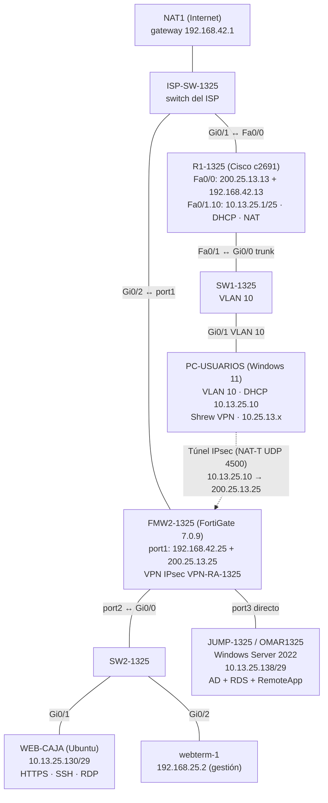

### Camino de una sesión del usuario

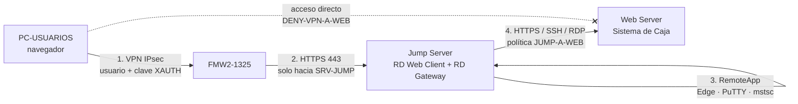

El usuario nunca habla directo con el Web Server. Abre la RemoteApp en el Jump Server, y es el Jump Server el que se conecta al Web Server.

### Qué decide lo que puede hacer cada usuario

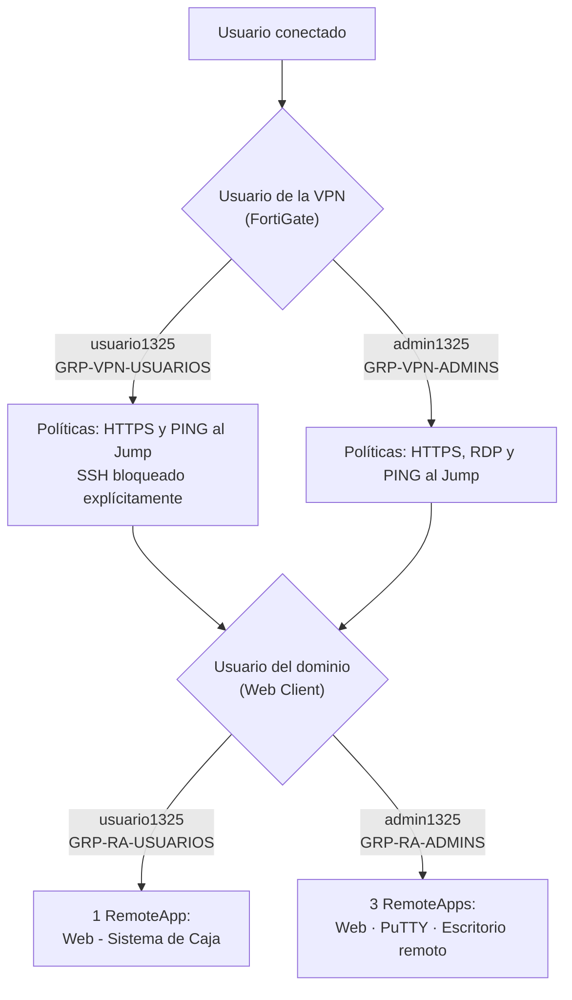

Hay dos capas de control: el **FortiGate** decide a qué puede llegar cada usuario por la red, y el **Jump Server** decide qué aplicaciones ve.

---

## 3. Direccionamiento IP

El direccionamiento lo derivé de mi matrícula **2025-1325**: `10.13.25.x` para las LAN, `10.25.13.x` para la VPN y `200.25.13.x` para las IP públicas simuladas.

| Segmento | Red | Gateway | Equipos |
| --- | --- | --- | --- |
| Usuarios (VLAN 10) | 10.13.25.0/25 | 10.13.25.1 (R1 Fa0/1.10) | PC-USUARIOS por DHCP (rango .10 – .100) |
| LAN del Web Server | 10.13.25.128/29 | 10.13.25.129 (FortiGate port2, IP secundaria) | WEB-CAJA: 10.13.25.130 |
| LAN del Jump Server | 10.13.25.136/29 | 10.13.25.137 (FortiGate port3) | OMAR1325: 10.13.25.138 |
| Clientes de la VPN | 10.25.13.10 – 10.25.13.20 | — | IP que el FortiGate entrega a cada cliente |
| IP públicas simuladas | 200.25.13.0/27 | — | R1: 200.25.13.13 · FortiGate: 200.25.13.25 |
| Salida a Internet (NAT1) | 192.168.42.0/24 | 192.168.42.1 | R1: 192.168.42.13 · FortiGate: 192.168.42.25 |
| Gestión del FortiGate | 192.168.25.0/24 | 192.168.25.1 (port2) | webterm-1: 192.168.25.2 |

### Decisiones de diseño

- **Dos /29 seguidas.** Una /29 tiene 8 direcciones (6 utilizables). `10.13.25.128/29` va de `.128` a `.135`, y la siguiente empieza justo en `.136` (hasta `.143`). No se solapan y no desperdician direcciones.
- **El Jump Server va directo a port3, sin switch.** Así está en su propia LAN, separada por el FortiGate de la LAN del Web Server. Cualquier tráfico entre los dos servidores pasa obligatoriamente por una política.
- **La VPN usa un rango propio (`10.25.13.x`).** Así el FortiGate distingue el tráfico que llega por el túnel del de las LAN, y los servidores ven la IP del cliente de VPN en sus registros.
- **Dos IP en la WAN del FortiGate.** La IP principal `192.168.42.25` sirve para salir a Internet por NAT1. La IP pública `200.25.13.25` es secundaria y en ella escucha la VPN.
- **IPsec en lugar de SSL-VPN.** FortiClient en Windows rechazó el TLS que ofrecía la SSL-VPN del FortiGate (error *SSL exit error*). Con IPsec DES/MD5, los mismos algoritmos que usé en la VPN Site-to-Site, el túnel se estableció. Shrew Soft VPN Client es un cliente IPsec gratuito compatible con esos algoritmos.

---

## 4. Cableado en GNS3

| Desde | Puerto | Hasta | Puerto |
| --- | --- | --- | --- |
| NAT1 | nat0 | ISP (ISP-SW-1325) | Gi0/0 |
| ISP | Gi0/1 | R1-1325 | Fa0/0 |
| ISP | Gi0/2 | FORTIGATE-1325 (FMW2-1325) | port1 |
| R1-1325 | Fa0/1 | SW1-1325 | Gi0/0 |
| SW1-1325 | Gi0/1 | PC-USUARIOS | Ethernet0 |
| FORTIGATE-1325 | port2 | IOSvL2-3 (SW2-1325) | Gi0/0 |
| IOSvL2-3 | Gi0/1 | WebServer | e0 (ens3) |
| IOSvL2-3 | Gi0/2 | webterm-1 | eth0 |
| FORTIGATE-1325 | port3 | JumpServer-1325 (OMAR1325) | Ethernet0 |

Entre paréntesis va el hostname configurado dentro del equipo cuando es distinto de la etiqueta del nodo en GNS3.

El Jump Server y el PC-USUARIOS son máquinas de VMware Workstation agregadas a GNS3 (*Edit → Preferences → VMware VMs*), con un adaptador e1000 y la opción *Allow GNS3 to use any configured VMware adapter*. Las enciendo y apago siempre desde GNS3, para que GNS3 conecte sus cables.

---

## 5. Credenciales del laboratorio

| Dónde | Usuario | Contraseña |
| --- | --- | --- |
| VPN (FortiGate), sin privilegios | usuario1325 | Usuario1325! |
| VPN (FortiGate), con privilegios | admin1325 | Admin1325! |
| Clave precompartida de la VPN | — | Clave1325! |
| Dominio y Web Client, sin privilegios | usuario1325@Omar1325.local | Usr#Lab2025! |
| Dominio y Web Client, con privilegios | admin1325@Omar1325.local | Adm#Lab2025! |
| Certificado de RDS (.pfx) | — | Cert1325! |
| SSH y RDP del Web Server | omar | Omar2025-1325 |

El nombre de usuario es el mismo en el FortiGate y en el dominio. La contraseña del dominio es distinta porque Windows no acepta una contraseña que contenga el nombre de la cuenta (`usuario1325` está dentro de `Usuario1325!`).

---

## 6. Equipos de red: ISP, R1 y switches

Los running-configs completos están en [`running-configs/`](JumpServer-RemoteApp/running-configs/).

### 6.1 ISP-SW-1325 (simula el ISP)

Switch de capa 2 que une NAT1 con la WAN del router y del FortiGate. En ese segmento conviven las IP públicas simuladas (`200.25.13.x`) y la red de salida a Internet (`192.168.42.x`).

| Puerto | Hacia | Modo |
| --- | --- | --- |
| Gi0/0 | NAT1 (Internet) | access |
| Gi0/1 | R1-1325 Fa0/0 | access + portfast edge |
| Gi0/2 | FMW2-1325 port1 | access + portfast edge |

### 6.2 R1-1325 (router de los usuarios)

El router hace todo lo que la red de los usuarios necesita: la VLAN 10, el DHCP y el NAT a Internet. A través de ese NAT el PC llega a la IP pública del FortiGate para levantar la VPN.

| Interfaz | Configuración |
| --- | --- |
| Fa0/0 (WAN) | `200.25.13.13/27` (pública) + `192.168.42.13/24` secundaria · `ip nat outside` |
| Fa0/1.10 (VLAN 10) | `encapsulation dot1Q 10` · `10.13.25.1/25` · `ip nat inside` |
| Ruta por defecto | `ip route 0.0.0.0 0.0.0.0 192.168.42.1` |

**DHCP de la VLAN 10:**

```
ip dhcp excluded-address 10.13.25.1 10.13.25.9
ip dhcp excluded-address 10.13.25.101 10.13.25.127
!
ip dhcp pool VLAN10-USUARIOS
   network 10.13.25.0 255.255.255.128
   default-router 10.13.25.1
   dns-server 8.8.8.8 1.1.1.1
```

Las exclusiones dejan el rango `.10 – .100` para los equipos de usuario.

**NAT (PAT) para salir a Internet:**

```
ip access-list extended NAT-USUARIOS
 permit ip 10.13.25.0 0.0.0.127 any
!
ip nat pool SALIDA-INTERNET 192.168.42.13 192.168.42.13 netmask 255.255.255.0
ip nat inside source list NAT-USUARIOS pool SALIDA-INTERNET overload
```

Todo el tráfico de la VLAN 10 sale traducido a `192.168.42.13`. Por eso el FortiGate ve llegar la VPN desde esa IP (columna *Remote Gateway* en la sección 7.9).

### 6.3 SW1-1325 (switch de los usuarios)

| Puerto | Descripción | Modo | VLAN |
| --- | --- | --- | --- |
| Gi0/0 | Troncal hacia R1 Fa0/1 | trunk dot1q, nonegotiate | permitidas 10, 99 · nativa 99 |
| Gi0/1 | PC-USUARIOS | access + portfast edge | 10 |
| Gi0/2 | Sin equipo conectado (la descripción quedó de una práctica anterior) | access + portfast edge | 99 |

Para esta práctica solo cambié la descripción de Gi0/1 ([`SW1-1325_puerto_pc.ios`](JumpServer-RemoteApp/scripts/cisco/SW1-1325_puerto_pc.ios)):

```
interface GigabitEthernet0/1
 description PC-USUARIOS
```

### 6.4 SW2-1325 (switch del Web Server)

| Puerto | Hacia | Modo |
| --- | --- | --- |
| Gi0/0 | FMW2-1325 port2 | access + portfast edge |
| Gi0/1 | WebServer | access + portfast edge |
| Gi0/2 | webterm-1 (gestión del FortiGate) | access + portfast edge |

---

## 7. FortiGate (FMW2-1325)

**Nota:** la configuración del FortiGate la hice **de forma gráfica (GUI)** desde el Firefox del webterm-1, entrando a `http://192.168.25.1`. La configuración completa en texto está en [`running-configs/FMW2-1325.conf`](JumpServer-RemoteApp/running-configs/FMW2-1325.conf).

### 7.1 Network → Interfaces

| Interfaz | Alias | Rol | IP principal | IP secundaria | Administrative Access |
| --- | --- | --- | --- | --- | --- |
| port1 | WAN-ISP | — | 192.168.42.25/24 | 200.25.13.25/27 (PING) | PING |
| port2 | LAN-SITIO2 | LAN | 192.168.25.1/24 (gestión) | 10.13.25.129/29 (PING) | PING, HTTPS, HTTP |
| port3 | LAN-JUMP | LAN | 10.13.25.137/29 | — | PING |
| VPN-RA-1325 | — | Túnel IPsec (sobre port1) | — | — | — |

- En `port2` la IP principal es la de gestión (webterm-1) y la secundaria `10.13.25.129/29` es el gateway del Web Server.
- En `port3` solo dejé PING. El Jump Server no puede administrar el FortiGate.
- En la WAN también solo PING, para no exponer la administración hacia Internet.

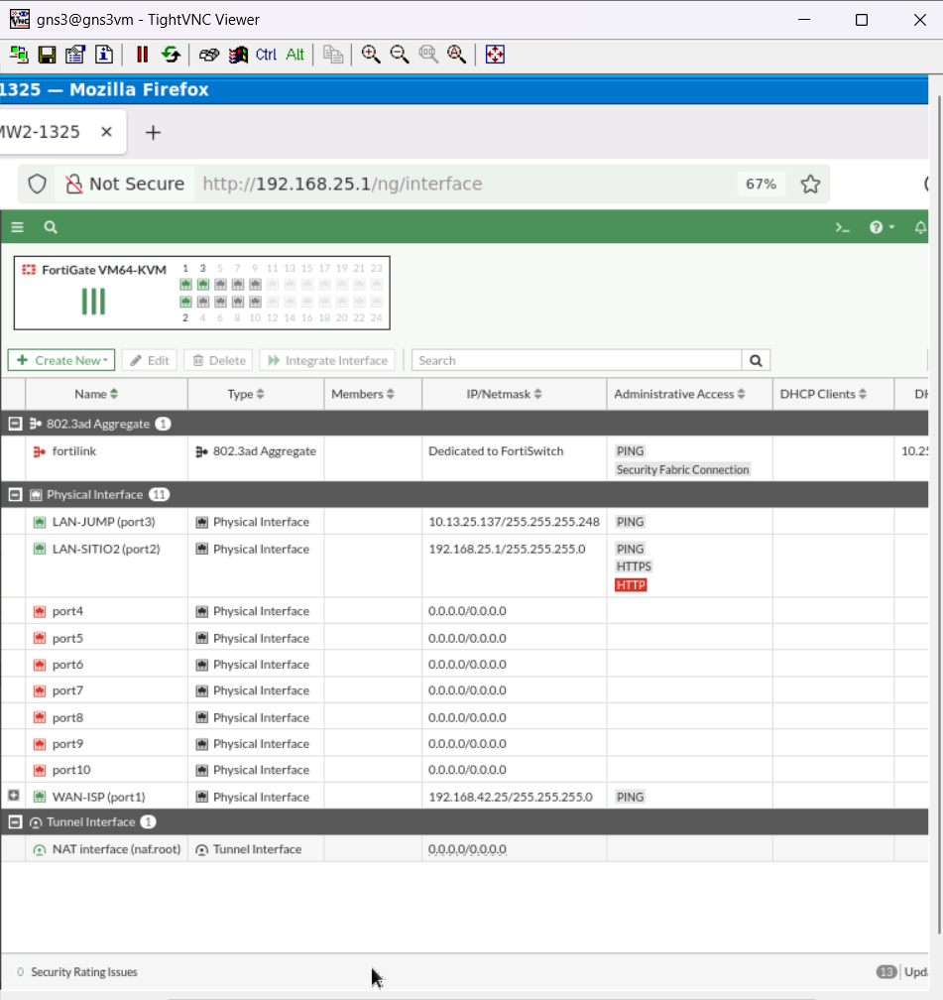

**port3 (LAN-JUMP):**

| Campo | Valor |
| --- | --- |
| Alias | LAN-JUMP |
| Role | LAN |
| Addressing mode | Manual |
| IP/Netmask | 10.13.25.137/255.255.255.248 |
| Create address object matching subnet | Desactivado (creé los objetos con nombres propios) |
| Administrative Access | PING |
| DHCP Server | Desactivado (el Jump Server tiene IP fija) |

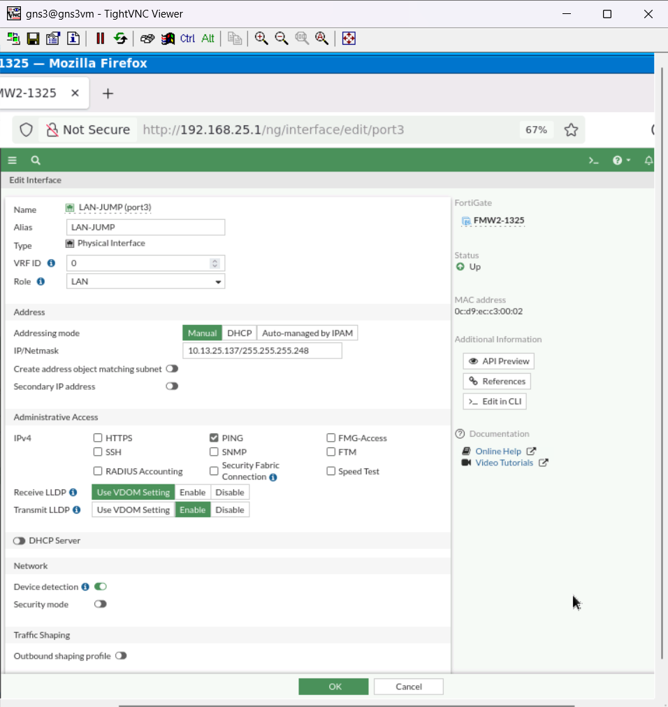

### 7.2 Network → Static Routes

| Destino | Gateway | Interfaz |
| --- | --- | --- |
| 0.0.0.0/0 | 192.168.42.1 | WAN-ISP (port1) |

### 7.3 Policy & Objects → Addresses

| Nombre | Tipo | Valor | Para qué |
| --- | --- | --- | --- |
| LAN-WEB | Subnet | 10.13.25.128/29 | LAN del Web Server (salida a Internet y DENY de la VPN) |
| SRV-WEB | Subnet | 10.13.25.130/32 | El Web Server |
| LAN-JUMP | Subnet | 10.13.25.136/29 | LAN del Jump Server (salida a Internet) |
| SRV-JUMP | Subnet | 10.13.25.138/32 | El Jump Server |
| VPN-POOL-1325 | IP Range | 10.25.13.10 – 10.25.13.20 | Origen de todo el tráfico que llega por la VPN |
| VPN-RA-DESTINOS | Address Group | SRV-JUMP + SRV-WEB | Redes que el túnel anuncia al cliente (*split tunnel*) |
| VPN-RA-1325_range / VPN-RA-1325_split | IP Range / Group | — | Los creó el asistente de VPN |

Todos los objetos tienen *Interface* **any**, para poder usarlos en políticas de cualquier par de interfaces.

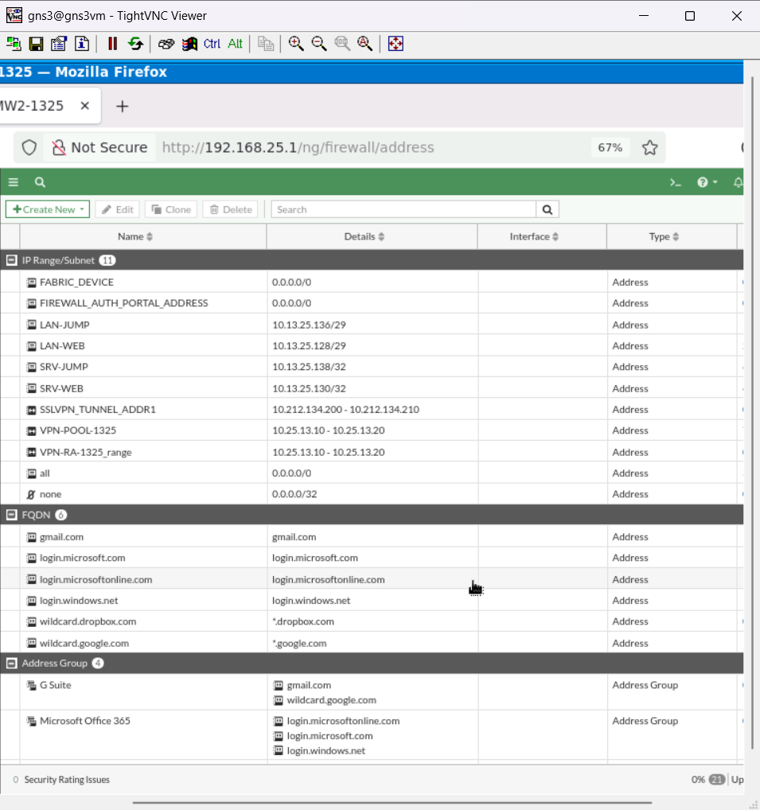

### 7.4 User & Authentication → User Definition y User Groups

| Usuario | Tipo | Grupo | Perfil |
| --- | --- | --- | --- |
| usuario1325 | Local User | GRP-VPN-USUARIOS (Firewall) | Sin privilegios |
| admin1325 | Local User | GRP-VPN-ADMINS (Firewall) | Con privilegios |

Las políticas usan **grupos**, no usuarios sueltos. Si mañana entra otro usuario sin privilegios, solo se agrega al grupo y hereda las mismas reglas.

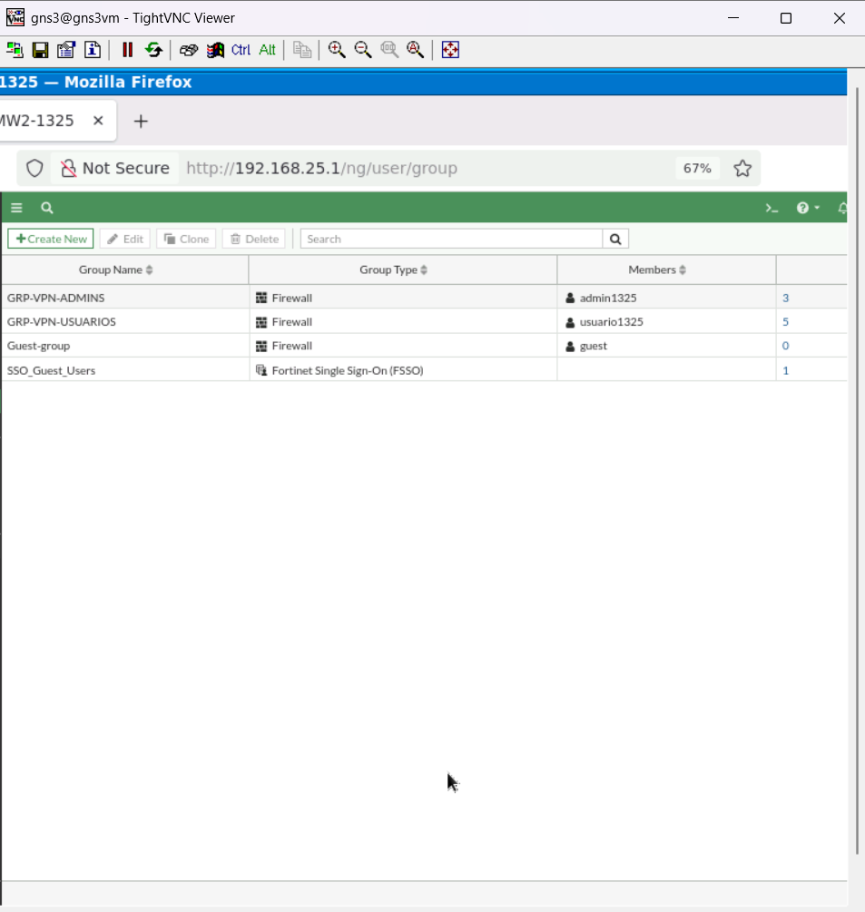

### 7.5 VPN → IPsec Wizard (VPN-RA-1325)

| Pantalla | Campo | Valor |
| --- | --- | --- |
| VPN Setup | Name | VPN-RA-1325 |
| | Template type | Remote Access |
| | Remote device type | Client-based → Cisco |
| Authentication | Incoming Interface | port1 (WAN-ISP) |
| | Authentication method | Pre-shared Key: `Clave1325!` |
| | User Group | GRP-VPN-USUARIOS (luego lo cambié a *Inherit from policy*) |
| Policy & Routing | Local Interface | port3 (LAN-JUMP) |
| | Local Address | VPN-RA-DESTINOS |
| | Client Address Range | 10.25.13.10 – 10.25.13.20 |
| | Subnet Mask | 255.255.255.255 |
| | Enable IPv4 Split Tunnel | Activado |

Después lo convertí en túnel personalizado (*Convert To Custom Tunnel*) para ajustar los algoritmos y la autenticación, y borré la política que crea el asistente: las reglas de la VPN son las de la sección 7.7.

### 7.6 Parámetros finales del túnel

**a) Network y Authentication**

| Campo | Valor | Por qué |
| --- | --- | --- |
| Remote Gateway | Dialup User | Los clientes se conectan desde cualquier IP |
| Interface | port1 | |
| Local Gateway | **200.25.13.25** | La IP pública es secundaria en port1 |
| IPv4 client address range | 10.25.13.10 – 10.25.13.20 /32 | Cada cliente recibe una IP del rango (*mode-config*) |
| Method | Pre-shared Key | |
| IKE Version / Mode | 1 / **Main (ID protection)** | Compatible con Shrew |
| Accept Types | Any peer ID | |

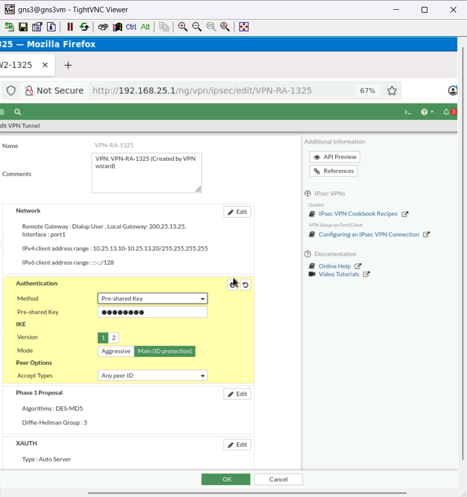

**b) Phase 1**

| Campo | Valor |
| --- | --- |
| Encryption / Authentication | DES / MD5 (una sola propuesta) |
| Diffie-Hellman Group | 5 |
| Key Lifetime | 86400 s |

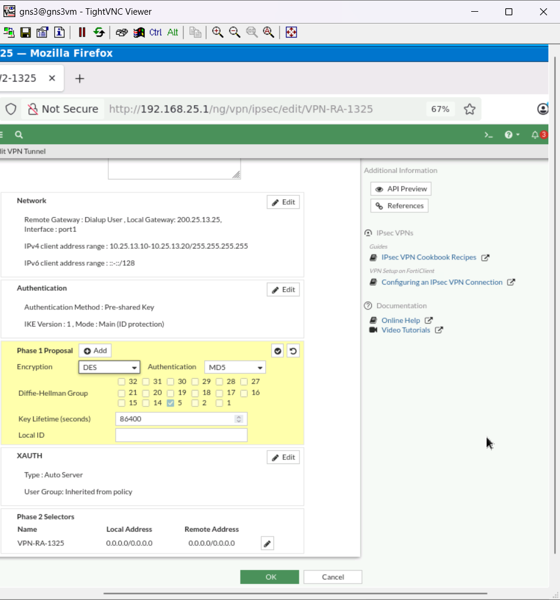

**c) XAUTH**

| Campo | Valor | Por qué |
| --- | --- | --- |
| Type | Auto Server | El FortiGate pide usuario y contraseña después de la Fase 1 |
| User Group | **Inherit from policy** | Sirven los dos grupos. Cada política decide qué grupo puede usarla, y así un mismo túnel aplica reglas distintas a cada usuario |

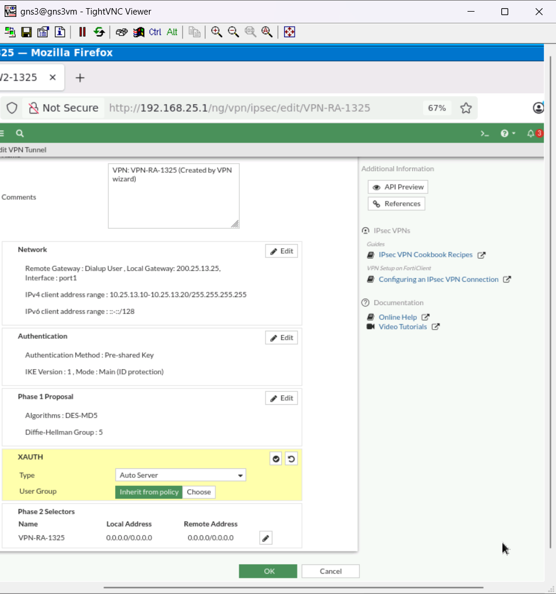

**d) Phase 2**

| Campo | Valor |
| --- | --- |
| Local / Remote Address | 0.0.0.0/0 ↔ 0.0.0.0/0 (los define el cliente) |
| Encryption / Authentication | DES / MD5 |
| Replay Detection | Activado |
| PFS | Activado, DH Group 5 |
| Autokey Keep Alive | Activado |
| Key Lifetime | 28800 s (Shrew no acepta más) |

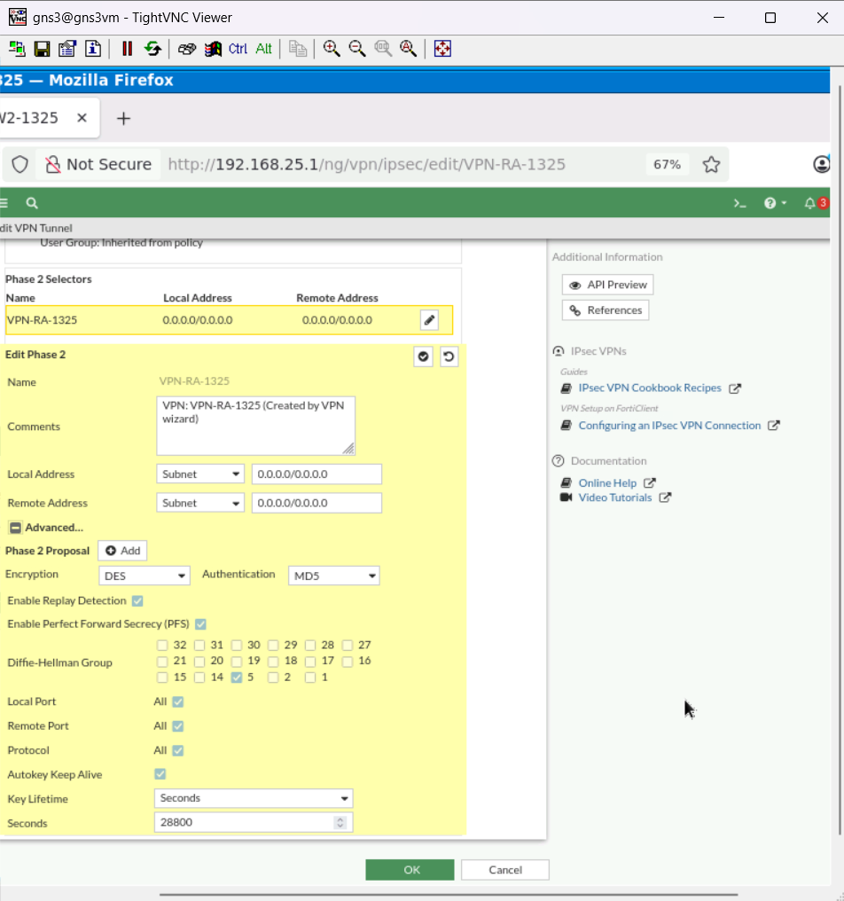

**Sobre DES/MD5:** la licencia de evaluación de FortiOS 7.0.9 solo permite cifrado de baja seguridad. En un entorno real usaría AES-256 con SHA-256 y DH 14 o superior.

### 7.7 Policy & Objects → Firewall Policy

En las políticas que salen del túnel, el campo **Source** lleva dos cosas: la dirección `VPN-POOL-1325` y el **grupo de usuarios**. Así el FortiGate aplica la política según quién está autenticado en la VPN.

| Orden | Nombre | Entrada → Salida | Origen | Destino | Servicio | Acción | NAT |
| --- | --- | --- | --- | --- | --- | --- | --- |
| 1 | DENY-USUARIO-SSH-JUMP | VPN-RA-1325 → LAN-JUMP (port3) | VPN-POOL-1325 + GRP-VPN-USUARIOS | SRV-JUMP | SSH | DENY | — |
| 2 | DENY-USUARIO-SSH-WEB | VPN-RA-1325 → LAN-SITIO2 (port2) | VPN-POOL-1325 + GRP-VPN-USUARIOS | SRV-WEB | SSH | DENY | — |
| 3 | VPN-USUARIOS-A-JUMP | VPN-RA-1325 → LAN-JUMP (port3) | VPN-POOL-1325 + GRP-VPN-USUARIOS | SRV-JUMP | HTTPS, PING | ACCEPT | Disabled |
| 4 | VPN-ADMINS-A-JUMP | VPN-RA-1325 → LAN-JUMP (port3) | VPN-POOL-1325 + GRP-VPN-ADMINS | SRV-JUMP | HTTPS, PING, RDP | ACCEPT | Disabled |
| 5 | DENY-VPN-A-WEB | VPN-RA-1325 → LAN-SITIO2 (port2) | VPN-POOL-1325 + GRP-VPN-USUARIOS + GRP-VPN-ADMINS | LAN-WEB | ALL | DENY | — |
| 6 | JUMP-A-WEB | LAN-JUMP (port3) → LAN-SITIO2 (port2) | SRV-JUMP | SRV-WEB | HTTPS, RDP, SSH | ACCEPT | Disabled |
| 7 | JUMP-INTERNET | LAN-JUMP (port3) → WAN-ISP (port1) | LAN-JUMP | all | ALL | ACCEPT | **Enabled** |
| 8 | WEB-INTERNET | LAN-SITIO2 (port2) → WAN-ISP (port1) | LAN-WEB | all | ALL | ACCEPT | **Enabled** |
| — | Implicit Deny | any → any | all | all | ALL | DENY | — |

Las ocho políticas registran el tráfico (columna *Log: All*): las ACCEPT con *All Sessions* y las DENY con *Log Violation Traffic*. Así cada intento bloqueado queda en el log con el nombre de su regla.

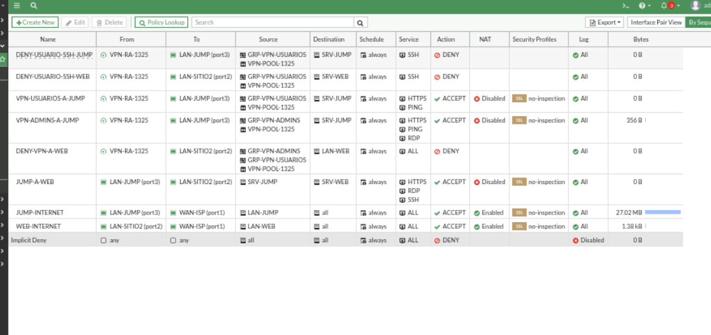

**Explicación de cada regla:**

- **1 y 2. DENY-USUARIO-SSH-JUMP y DENY-USUARIO-SSH-WEB:** son las políticas explícitas que restringen el SSH del usuario sin privilegios, hacia el Jump Server y hacia el Web Server. El Implicit Deny ya lo bloquearía, pero con reglas propias cada intento queda en el log con el nombre de la regla que lo bloqueó. Van arriba de todo: un bloqueo explícito siempre encima de los permisos que se le parezcan.
- **3. VPN-USUARIOS-A-JUMP:** el usuario sin privilegios solo llega al Jump Server, por HTTPS (el RD Web Client) y PING.
- **4. VPN-ADMINS-A-JUMP:** el usuario con privilegios llega al Jump Server por HTTPS, PING y también por RDP directo (puerto 3389).
- **5. DENY-VPN-A-WEB:** nadie de la VPN, ni siquiera el admin, entra directo a la LAN del Web Server. Es la regla que hace cumplir que **la VPN solo da acceso al Jump Server**.
- **6. JUMP-A-WEB:** el Jump Server solo puede usar HTTPS, RDP y SSH contra el Web Server. Sin NAT, para que el Web Server vea la IP real del Jump (`10.13.25.138`) en sus registros.
- **7. JUMP-INTERNET:** el Jump Server sale a Internet con NAT para descargar PuTTY, el Web Client y actualizaciones de Windows.
- **8. WEB-INTERNET:** salida a Internet del Web Server, con NAT, para sus actualizaciones.
- **Implicit Deny:** bloquea todo lo demás. Por ejemplo, el Web Server no puede iniciar conexiones hacia el Jump Server, el Jump no puede usar HTTP (80) contra el Web Server, y desde Internet no se llega a ninguna LAN.

**NAT apagado en las políticas de la VPN:** el Jump Server ve la IP del túnel (`10.25.13.x`) y le responde a través del FortiGate, que es su gateway. Así cada sesión del Jump queda asociada al cliente de VPN real.

### 7.8 Estado de la VPN

En *Dashboard → Network → IPsec* aparece la sesión de cada cliente conectado (`VPN-RA-1325_0`, `VPN-RA-1325_1`...), con Fase 1 y Fase 2 en verde. El **Remote Gateway** es `192.168.42.13`, la IP con la que el PC sale por el NAT del R1.

Conectado como usuario1325:

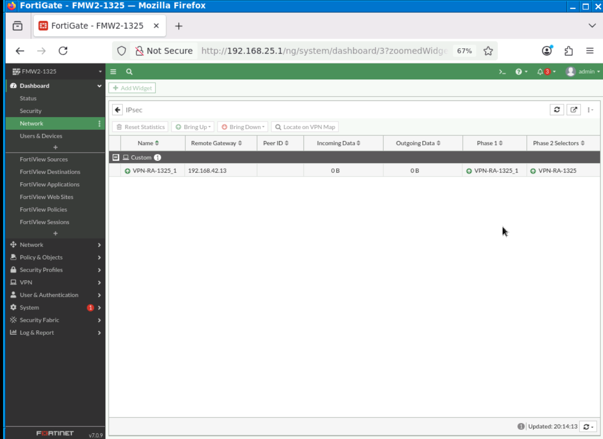

Conectado como admin1325:

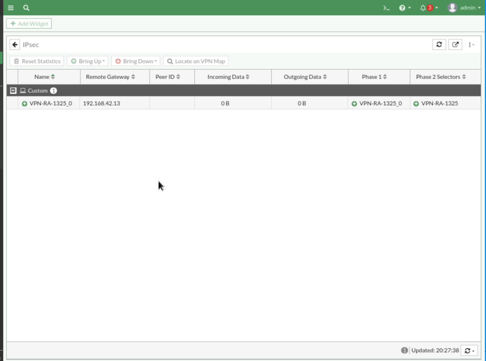

---

## 8. Web Server "Sistema de Caja"

**Imagen:** Ubuntu Cloud 24.04, hostname `WEBSERVER-1325`. Ya tenía Apache con HTTPS y SSH. Para esta práctica le cambié la red a /29 y le agregué RDP. Los comandos están en [`webserver_setup.sh`](JumpServer-RemoteApp/scripts/webserver/webserver_setup.sh).

### 8.1 Red (/etc/netplan/50-cloud-init.yaml)

```yaml
network:
  version: 2
  ethernets:
    ens3:
      dhcp4: false
      addresses: [10.13.25.130/29]
      mtu: 1400
      routes:
        - to: default
          via: 10.13.25.129
      nameservers:
        addresses: [8.8.8.8, 1.1.1.1]
```

`mtu: 1400` deja espacio a las cabeceras que se añaden en el camino. Así evito que los paquetes grandes de HTTPS se fragmenten.

### 8.2 Los tres servicios que permite la política JUMP-A-WEB

| Servicio | Puerto | Configuración |
| --- | --- | --- |
| HTTPS | 443 | Apache con `default-ssl` y la página `<h1>Sistema de Caja - Web Server - Omar Paulino 20251325</h1>` |
| SSH | 22 | OpenSSH con `PasswordAuthentication yes` en `/etc/ssh/sshd_config.d/01-lab.conf`, usuario `omar` |
| RDP | 3389 | xrdp instalado sin escritorio (`apt install --no-install-recommends xrdp`) |

```bash
sudo apt clean
sudo journalctl --vacuum-size=20M
sudo apt install --no-install-recommends xrdp
sudo adduser xrdp ssl-cert
sudo systemctl enable --now xrdp
```

El disco del Ubuntu Cloud es pequeño (2.4 GB), así que instalé solo el servidor xrdp, sin entorno gráfico. Al conectarse por RDP aparece la pantalla de login de xrdp. Eso demuestra que el puerto 3389 está abierto y que el FortiGate deja pasar el RDP desde el Jump Server.

En Ubuntu 24.04 el SSH funciona por **activación de socket**: `systemd` escucha el puerto 22 y arranca `sshd` cuando llega una conexión. Por eso en la verificación el puerto 22 aparece a nombre de `systemd`.

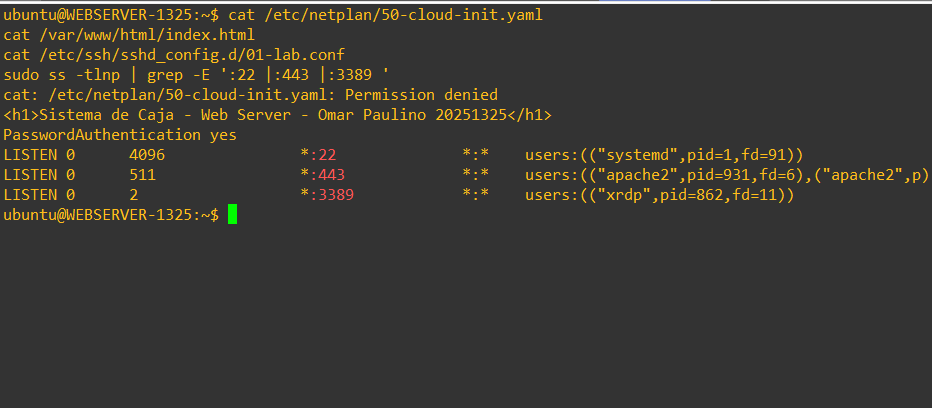

---

## 9. Jump Server (OMAR1325)

**Sistema:** Windows Server 2022 (VMware), controlador del dominio `Omar1325.local`.

| Dato | Valor |
| --- | --- |
| Nombre del servidor | OMAR1325 |
| FQDN | omar1325.omar1325.local |
| Dominio / NetBIOS | Omar1325.local / OMAR-1325 |
| IP | 10.13.25.138/29, gateway 10.13.25.137, DNS 127.0.0.1 |
| Roles | AD DS, DNS, Remote Desktop Services (Host de sesión, Agente de conexión, Acceso web, Puerta de enlace y Licencias) |

Los scripts de PowerShell están en [`scripts/jump-server/`](JumpServer-RemoteApp/scripts/jump-server/) y la configuración exportada en [`JUMP-1325_configuracion.txt`](JumpServer-RemoteApp/running-configs/JUMP-1325_configuracion.txt).

### 9.1 Red y DNS

- IP fija `10.13.25.138/29` con gateway `10.13.25.137` (port3 del FortiGate) y DNS `127.0.0.1`, porque el servidor es el DNS de su propio dominio.
- En el DNS configuré un **reenviador** a `8.8.8.8` (*DNS → Propiedades → Reenviadores*) para que el servidor resuelva nombres de Internet.
- Borré los registros A del servidor que apuntaban a su IP anterior. RDS y el Web Client se conectan por el nombre `omar1325.omar1325.local`, que debe resolver a `10.13.25.138`.
- Activé la regla del Firewall de Windows que responde al ping:

```powershell
Enable-NetFirewallRule -Name FPS-ICMP4-ERQ-In
ipconfig /registerdns
```

### 9.2 Usuarios y grupos del dominio

```powershell
New-ADUser -Name "Usuario Sin Privilegios" -SamAccountName usuario1325 -UserPrincipalName usuario1325@Omar1325.local -AccountPassword (ConvertTo-SecureString 'Usr#Lab2025!' -AsPlainText -Force) -Enabled $true -PasswordNeverExpires $true
New-ADUser -Name "Admin Con Privilegios" -SamAccountName admin1325 -UserPrincipalName admin1325@Omar1325.local -AccountPassword (ConvertTo-SecureString 'Adm#Lab2025!' -AsPlainText -Force) -Enabled $true -PasswordNeverExpires $true
New-ADGroup -Name GRP-RA-USUARIOS -GroupScope Global -GroupCategory Security
New-ADGroup -Name GRP-RA-ADMINS  -GroupScope Global -GroupCategory Security
Add-ADGroupMember -Identity GRP-RA-USUARIOS -Members usuario1325
Add-ADGroupMember -Identity GRP-RA-ADMINS  -Members admin1325
Add-ADGroupMember -Identity S-1-5-32-555 -Members GRP-RA-USUARIOS, GRP-RA-ADMINS
```

| Grupo | Miembro | Para qué |
| --- | --- | --- |
| GRP-RA-USUARIOS | usuario1325 | RemoteApps del usuario sin privilegios |
| GRP-RA-ADMINS | admin1325 | RemoteApps del usuario con privilegios |
| Usuarios de escritorio remoto (`S-1-5-32-555`) | Los dos grupos | Permite iniciar sesión por RDS. Uso el SID porque el nombre del grupo cambia según el idioma de Windows |

"Con privilegios" significa que tiene más herramientas publicadas, **no** que sea administrador del dominio. Por eso `admin1325` es una cuenta normal.

### 9.3 Permiso de inicio de sesión por RDS en el controlador de dominio

En un controlador de dominio solo los administradores pueden entrar por Escritorio remoto. Lo cambié en la GPO **Default Domain Controllers Policy** → *Configuración del equipo → Directivas → Configuración de Windows → Configuración de seguridad → Directivas locales → Asignación de derechos de usuario* → **Permitir inicio de sesión a través de Servicios de Escritorio remoto**: **Administradores** y **Usuarios de escritorio remoto**. Después ejecuté `gpupdate /force`.

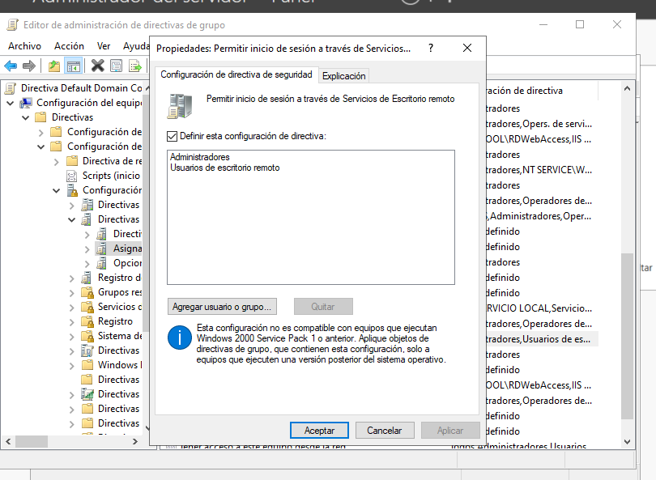

### 9.4 Remote Desktop Services

**Instalación** (*Administrar → Agregar roles y características*):

| Paso | Opción |
| --- | --- |
| Tipo de instalación | Instalación de Servicios de Escritorio remoto |
| Tipo de implementación | Inicio rápido |
| Escenario | Implementación de escritorio basada en sesión |
| Servidor | OMAR1325.Omar1325.local |

El inicio rápido instala el **Host de sesión** (ejecuta las aplicaciones), el **Agente de conexión** (reparte las conexiones) y el **Acceso web** (el portal), y crea la colección `QuickSessionCollection`.

**Roles añadidos después** (*Información general de implementación*, botones verdes `+`):

| Rol | Por qué |
| --- | --- |
| Puerta de enlace de Escritorio remoto (RD Gateway) | El Web Client habla HTTPS con la puerta de enlace, y esta abre la sesión RDP por dentro. Así el usuario solo necesita el puerto 443 |
| Administración de licencias | Modo **Por usuario** (`PerUser`), servidor OMAR1325.Omar1325.local |

En *Editar propiedades de implementación → Puerta de enlace* elegí el nombre `omar1325.omar1325.local`, autenticación por contraseña y *Usar credenciales de Puerta de enlace para equipos remotos*.

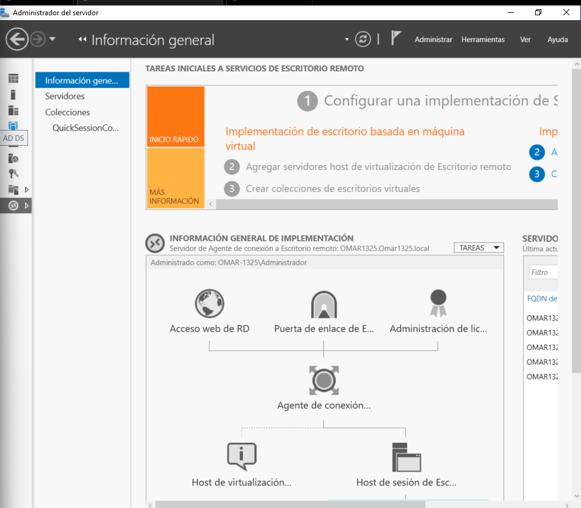

### 9.5 Certificado

Los cuatro servicios de rol usan el mismo certificado `CN=omar1325.omar1325.local`, creado en *Propiedades de implementación → Certificados → Crear nuevo certificado* y guardado como `C:\Certs\rds1325.pfx`.

| Servicio de rol | Estado |
| --- | --- |
| Agente de conexión: habilitar inicio de sesión único | Correcto |
| Agente de conexión: publicación | Correcto |
| Acceso web a Escritorio remoto | Correcto |
| Puerta de enlace de Escritorio remoto | Correcto |

La columna *Nivel* dice "No es de confianza" porque el certificado es autofirmado. Es lo normal en un laboratorio: lo que cuenta es que los cuatro estén en **Correcto** y que el PC tenga instalada la parte pública del certificado (sección 10.4).

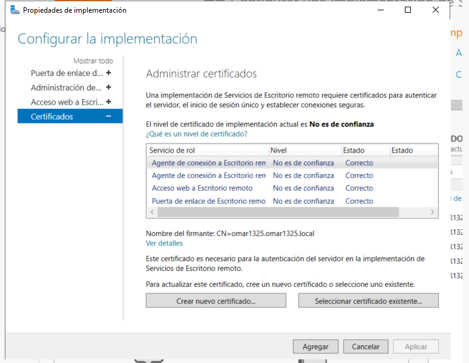

Exporté la parte pública y la dejé en el IIS de Acceso web para que el PC la descargue por la VPN:

```powershell
$thumb = (Get-RDCertificate -Role RDPublishing).Thumbprint
$cert  = Get-Item "Cert:\LocalMachine\My\$thumb"
Export-Certificate -Cert $cert -FilePath C:\Certs\rds1325.cer -Force
Import-Certificate -FilePath C:\Certs\rds1325.cer -CertStoreLocation Cert:\LocalMachine\Root
Copy-Item C:\Certs\rds1325.cer C:\inetpub\wwwroot\rds1325.cer -Force
```

Busco el certificado por la huella que tiene asignada RDS (`Get-RDCertificate`) y no por su nombre, porque en el servidor hay varios certificados con el mismo nombre.

### 9.6 PuTTY

Edge ya viene en Windows Server 2022. PuTTY lo descargué de su sitio oficial:

```powershell
[Net.ServicePointManager]::SecurityProtocol = [Net.SecurityProtocolType]::Tls12
New-Item -ItemType Directory "C:\Program Files\PuTTY" -Force
Invoke-WebRequest https://the.earth.li/~sgtatham/putty/latest/w64/putty.exe -OutFile "C:\Program Files\PuTTY\putty.exe"
```

### 9.7 RemoteApps y asignación por grupo

En *Servicios de Escritorio remoto → Colecciones → QuickSessionCollection*:

1. **Grupos de la colección:** quité *Usuarios del dominio* y dejé solo `GRP-RA-USUARIOS` y `GRP-RA-ADMINS`.
2. **Quité las apps de ejemplo** (Calculadora, Paint y WordPad).
3. **Publiqué las tres apps** y configuré cada una:

| RemoteApp | Programa | Parámetros | Asignación de usuarios |
| --- | --- | --- | --- |
| Web - Sistema de Caja | `msedge.exe` | Siempre `https://10.13.25.130` | GRP-RA-USUARIOS y GRP-RA-ADMINS |
| PuTTY (SSH) | `C:\Program Files\PuTTY\putty.exe` | No permitidos | GRP-RA-ADMINS |
| Escritorio remoto (RDP) | `C:\Windows\system32\mstsc.exe` | No permitidos | GRP-RA-ADMINS |

- El parámetro fijo de Edge hace que la app **Web** abra directamente el Sistema de Caja. Al ser obligatorio, el usuario no puede usarla para abrir otra dirección.
- La **Asignación de usuarios** es lo que cumple el requisito: el Web Client solo muestra a cada usuario las apps de sus grupos.

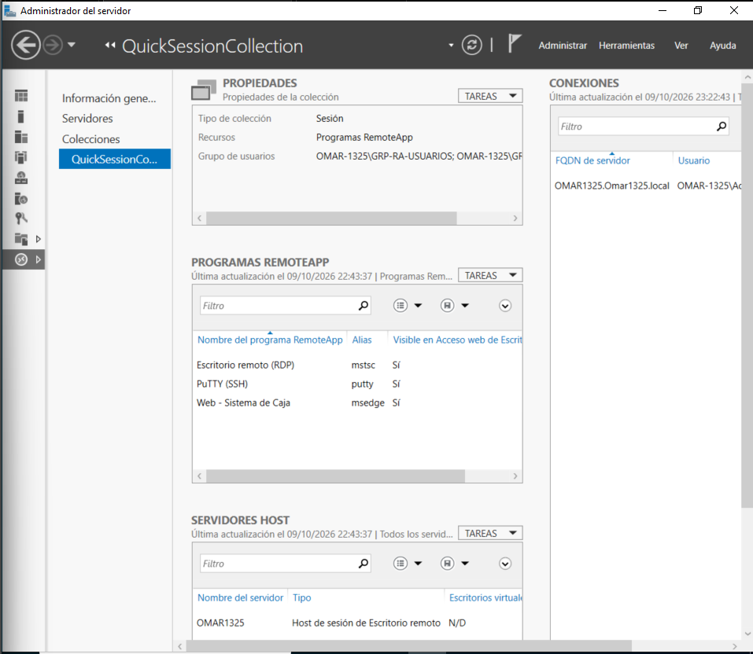

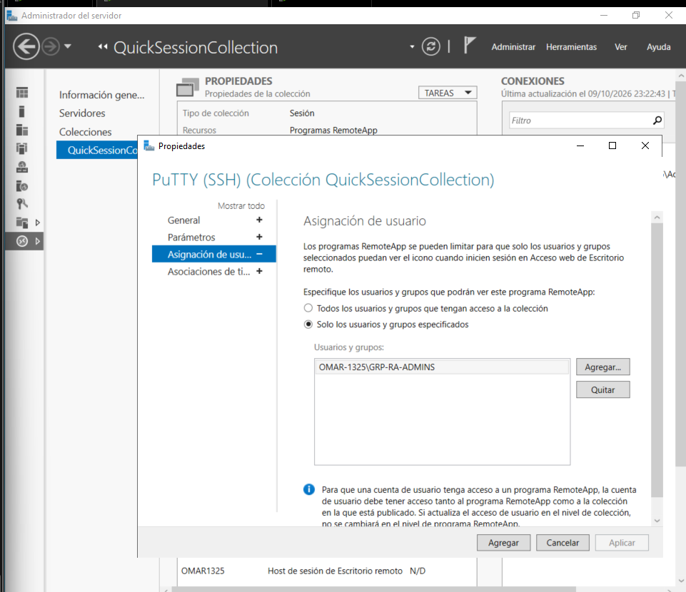

### 9.8 RD Web Client (HTML5)

El Web Client abre las RemoteApps desde el navegador del PC, sin instalar el cliente de Escritorio remoto:

```powershell
[Net.ServicePointManager]::SecurityProtocol = [Net.SecurityProtocolType]::Tls12
Install-PackageProvider -Name NuGet -Force
Install-Module -Name PowerShellGet -Force
# (cerrar y abrir otra PowerShell como administrador)
Install-Module -Name RDWebClientManagement -Force -AcceptLicense
Install-RDWebClientPackage
Import-RDWebClientBrokerCert C:\Certs\rds1325.cer
Publish-RDWebClientPackage -Type Production -Latest
```

| Comando | Para qué |
| --- | --- |
| `Install-PackageProvider NuGet` / `Install-Module PowerShellGet` | Permiten descargar módulos de la PowerShell Gallery |
| `Install-Module RDWebClientManagement` | Herramientas de Microsoft para gestionar el Web Client |
| `Install-RDWebClientPackage` | Descarga el Web Client |
| `Import-RDWebClientBrokerCert` | Le da al Web Client el certificado del Agente de conexión |
| `Publish-RDWebClientPackage -Type Production -Latest` | Lo publica en `https://omar1325.omar1325.local/RDWeb/webclient/` |

---

## 10. PC-USUARIOS: VPN y RemoteApp Web Client

**Sistema:** Windows 11 en VMware, conectado a SW1 Gi0/1 (VLAN 10). Recibe por DHCP del R1 la IP `10.13.25.10/25`, gateway `10.13.25.1`. Es el mismo PC para los dos usuarios: el usuario se elige al conectar la VPN y al entrar al Web Client.

### 10.1 Shrew Soft VPN Client

Instalé Shrew Soft VPN Client 2.2.2 (edición Standard, gratuita) desde `https://www.shrew.net/download/vpn` y creé el perfil **VPN-1325** en *VPN Access Manager → Add*. Los parámetros también están en [`shrew_VPN-1325_parametros.txt`](JumpServer-RemoteApp/scripts/pc-usuarios/shrew_VPN-1325_parametros.txt).

| Pestaña | Campo | Valor |
| --- | --- | --- |
| General | Host Name or IP Address / Port | 200.25.13.25 / 500 |
| | Auto Configuration | ike config pull |
| | Adapter Mode | Use a virtual adapter and assigned address (Obtain Automatically) |
| | MTU | 1300 |
| Client | NAT Traversal | force-rfc (UDP 4500) |
| | IKE Fragmentation | enable |
| | Dead Peer Detection / ISAKMP Failure Notifications | Marcados |
| Name Resolution | DNS / WINS | Desmarcados (uso el archivo hosts) |
| Authentication | Authentication Method | Mutual PSK + XAuth |
| | Local / Remote Identity | IP Address (automática) |
| | Pre Shared Key | Clave1325! |
| Phase 1 | Exchange Type / DH Exchange | main / group 5 |
| | Cipher / Hash | des / md5 |
| | Key Life Time limit | 86400 |
| Phase 2 | Transform / HMAC | esp-des / md5 |
| | PFS Exchange / Compress | group 5 / disabled |
| | Key Life Time limit | 28800 |
| Policy | Policy Generation Level | unique |
| | Obtain Topology Automatically | Desmarcado |
| | Remote Network Resource | include `10.13.25.128 / 255.255.255.240` |

- **Los parámetros coinciden con los del FortiGate** (sección 7.6). Si una sola fase no coincide, el túnel no negocia.
- **La red de la pestaña Policy la puse a mano.** Con *Obtain Topology Automatically*, Shrew negociaba un selector que no coincidía con el del FortiGate, y las respuestas se descartaban (*No matching IPsec selector*). La red `10.13.25.128/28` cubre las dos LAN de servidores (`.128/29` y `.136/29`). Aun así, el FortiGate solo deja pasar lo que permiten las políticas.
- **MTU 1300** evita que los paquetes dentro del túnel superen el tamaño máximo y se pierdan.

Al conectar, Shrew pide el usuario y la contraseña de la **VPN** (`usuario1325` / `Usuario1325!` o `admin1325` / `Admin1325!`). El adaptador virtual recibe una IP `10.25.13.x`.

### 10.2 Archivo hosts

El certificado y el Web Client usan el nombre `omar1325.omar1325.local`, y fuera del dominio no hay un DNS que lo conozca. Lo agregué a `C:\Windows\System32\drivers\etc\hosts`:

```
10.13.25.138    omar1325.omar1325.local
```

### 10.3 Confianza en el certificado del Jump Server

Con la VPN conectada, descargué `https://omar1325.omar1325.local/rds1325.cer` y lo instalé en **Equipo local → Entidades de certificación raíz de confianza**. Sin este paso el portal carga, pero al abrir una app sale *"No pudimos conectarnos a la puerta de enlace"*: el navegador no abre la conexión con el RD Gateway si no confía en su certificado.

### 10.4 RemoteApp Web Client

En `https://omar1325.omar1325.local/RDWeb/webclient/` el usuario inicia sesión con su cuenta del **dominio**. Uso una ventana normal del navegador, no InPrivate: el Web Client necesita guardar datos en el navegador.

**usuario1325 (sin privilegios):**

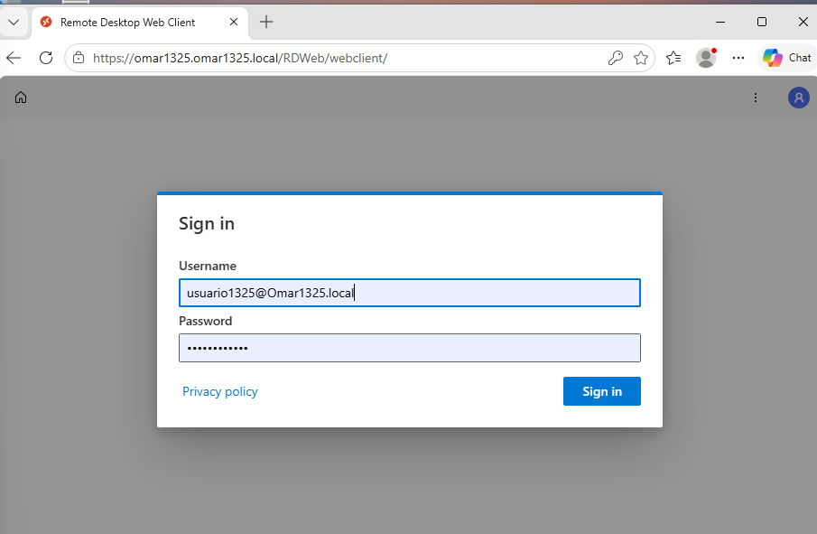

Solo ve una app: **Web - Sistema de Caja**.

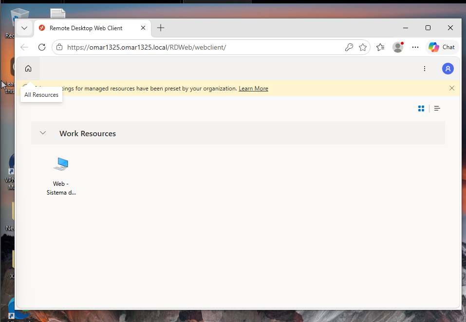

**admin1325 (con privilegios):**

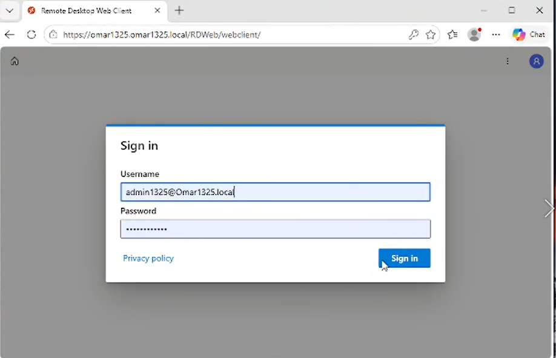

Ve las tres apps: **Escritorio remoto (RDP)**, **PuTTY (SSH)** y **Web - Sistema de Caja**.

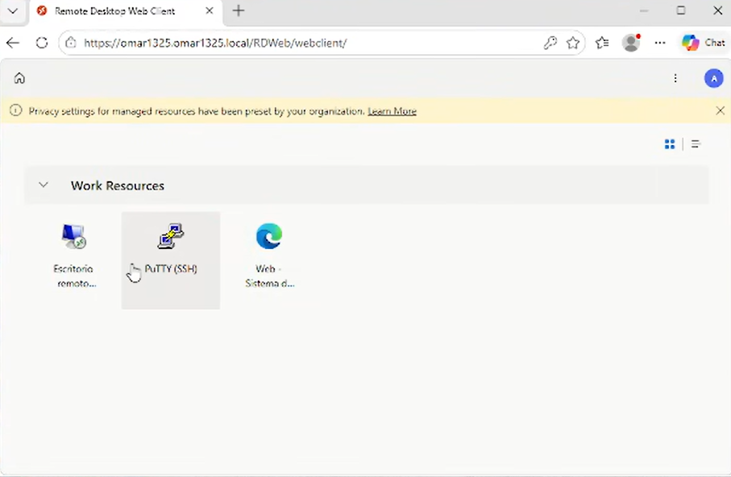

### 10.5 Cambiar de usuario en el mismo PC

| Paso | Qué cambia |
| --- | --- |
| 1. Cerrar sesión en el Web Client y cerrar el navegador | — |
| 2. Desconectar Shrew y conectar con el otro usuario de VPN | Las políticas del FortiGate que se aplican (grupo GRP-VPN-USUARIOS o GRP-VPN-ADMINS) |
| 3. Entrar al Web Client con la otra cuenta del dominio | Las RemoteApps que se ven (una o tres) |

---

## 11. Resumen de las reglas de acceso

| Origen | Destino | Servicio | Resultado | Dónde se controla |
| --- | --- | --- | --- | --- |
| PC sin VPN | Cualquier servidor | Todo | Bloqueado | No existe ninguna política desde la WAN hacia las LAN |
| VPN usuario1325 | Jump Server | HTTPS, PING | Permitido | VPN-USUARIOS-A-JUMP |
| VPN usuario1325 | Jump Server | SSH | **Bloqueado (regla explícita)** | DENY-USUARIO-SSH-JUMP |
| VPN usuario1325 | Web Server | SSH | **Bloqueado (regla explícita)** | DENY-USUARIO-SSH-WEB |
| VPN usuario1325 | Jump Server | RDP | Bloqueado | Implicit Deny |
| VPN admin1325 | Jump Server | HTTPS, RDP, PING | Permitido | VPN-ADMINS-A-JUMP |
| Cualquier usuario de VPN | LAN del Web Server | Todo | Bloqueado | DENY-VPN-A-WEB |
| Jump Server | Web Server | HTTPS, RDP, SSH | Permitido | JUMP-A-WEB |
| Jump Server | Web Server | Cualquier otro (p. ej. HTTP 80) | Bloqueado | Implicit Deny |
| Web Server | Jump Server | Todo | Bloqueado | Implicit Deny |
| Jump Server y Web Server | Internet | Todo | Permitido con NAT | JUMP-INTERNET / WEB-INTERNET |
| usuario1325 en el Web Client | RemoteApps | — | Solo Web | Asignación de usuarios (GRP-RA-USUARIOS) |
| admin1325 en el Web Client | RemoteApps | — | Web, PuTTY y RDP | Asignación de usuarios (GRP-RA-ADMINS) |

---

## 12. Pruebas y resultados

La demostración completa está en el [video](#video-de-demostración). Los comandos de prueba están en [`pruebas.ps1`](JumpServer-RemoteApp/scripts/pc-usuarios/pruebas.ps1). En Windows uso `Test-NetConnection`: `TcpTestSucceeded : True` significa que el puerto pasa y `False` que está bloqueado.

| # | Desde | Prueba | Resultado | Requisito que demuestra |
| --- | --- | --- | --- | --- |
| 1 | PC-USUARIOS sin VPN | `ping 10.13.25.138` | Falla | Los servidores no se ven sin VPN |
| 2 | VPN usuario1325 | `ping omar1325.omar1325.local` | Responde 10.13.25.138 | La VPN da acceso al Jump Server |
| 3 | VPN usuario1325 | `Test-NetConnection 10.13.25.138 -Port 443` | True | El Web Client es accesible |
| 4 | VPN usuario1325 | Web Client como usuario1325 | Solo **Web - Sistema de Caja**, que abre la página | Usuario sin privilegios: solo Web |
| 5 | VPN usuario1325 | `Test-NetConnection 10.13.25.138 -Port 22` | False · log DENY-USUARIO-SSH-JUMP | Regla explícita contra SSH |
| 6 | VPN usuario1325 | `Test-NetConnection 10.13.25.130 -Port 22` | False · log DENY-USUARIO-SSH-WEB | Regla explícita contra SSH |
| 7 | VPN usuario1325 | `Test-NetConnection 10.13.25.130 -Port 443` | False · log DENY-VPN-A-WEB | La VPN solo llega al Jump |
| 8 | VPN admin1325 | Web Client como admin1325 | Web, PuTTY y Escritorio remoto | Usuario con privilegios |
| 9 | App PuTTY (admin1325) | SSH a 10.13.25.130 como `omar` | Entra a la consola del Web Server | Jump → Web por SSH |
| 10 | App Escritorio remoto (admin1325) | RDP a 10.13.25.130 | Aparece la pantalla de login de xrdp | Jump → Web por RDP |
| 11 | App Web (admin1325) | App Web publicada junto a las demas aplicaciones| Carga por HTTPS (Misma app que se abre en la prueba 4) | Jump → Web por HTTPS |
| 12 | VPN admin1325 | `Test-NetConnection 10.13.25.138 -Port 3389` | True (origen 10.25.13.10) | RDP del admin al Jump |
| 13 | VPN admin1325 | `Test-NetConnection 10.13.25.130 -Port 22` | False · log DENY-VPN-A-WEB | Ni el admin entra directo al Web Server |

### 12.1 RDP del usuario con privilegios al Jump Server

Conectado a la VPN como admin1325, el puerto 3389 del Jump Server responde (`TcpTestSucceeded : True`). La conexión sale desde la IP del túnel `10.25.13.10`, por el adaptador virtual de Shrew, y la permite la política **VPN-ADMINS-A-JUMP**. Con usuario1325 ese mismo puerto no pasa, porque su política solo permite HTTPS y PING.

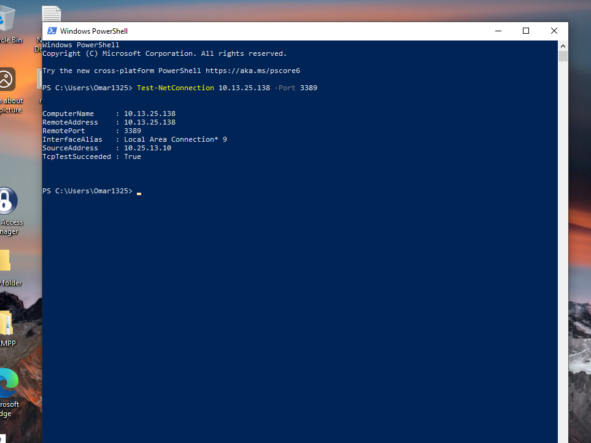

### 12.2 Evidencia en los logs del FortiGate

En *Log & Report → Forward Traffic* se ve el tráfico aceptado: las sesiones de `usuario1325` y `admin1325` hacia el Jump (`10.13.25.138`) por **VPN-USUARIOS-A-JUMP** y **VPN-ADMINS-A-JUMP**, las conexiones del Jump al Web Server por **JUMP-A-WEB**, y la salida a Internet de los dos servidores:

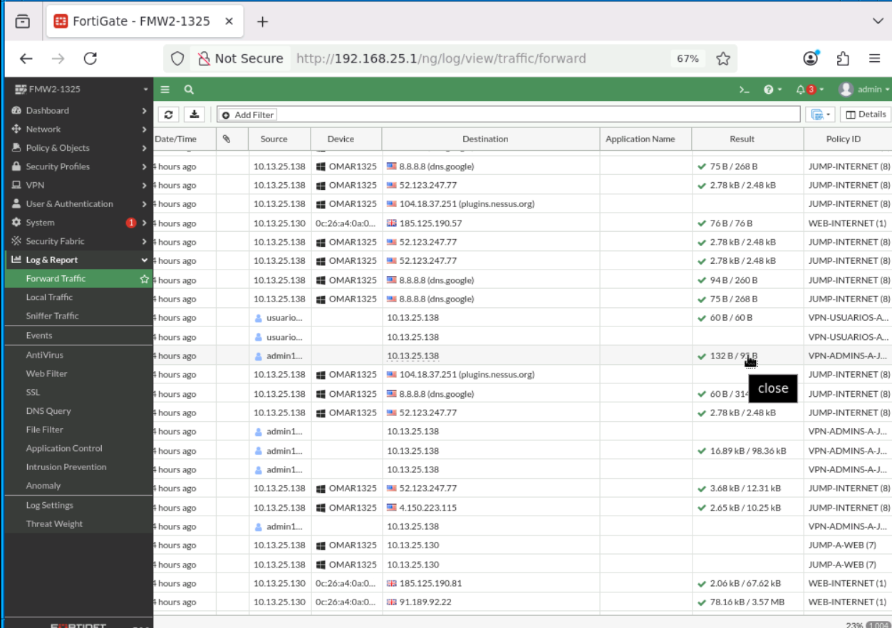

Y los bloqueos: los intentos de `usuario1325 (10.25.13.10)` hacia `10.13.25.138` y `10.13.25.130` terminan en **Deny: policy violation**:

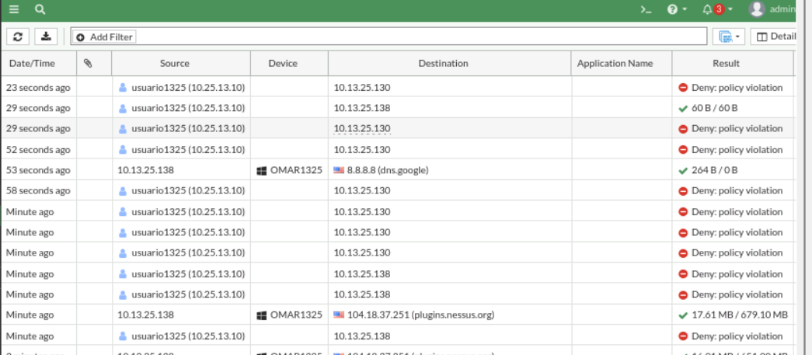

En la columna *Source* el FortiGate muestra el **nombre del usuario de la VPN** junto a su IP del túnel. Así queda auditado qué usuario hizo cada intento.
